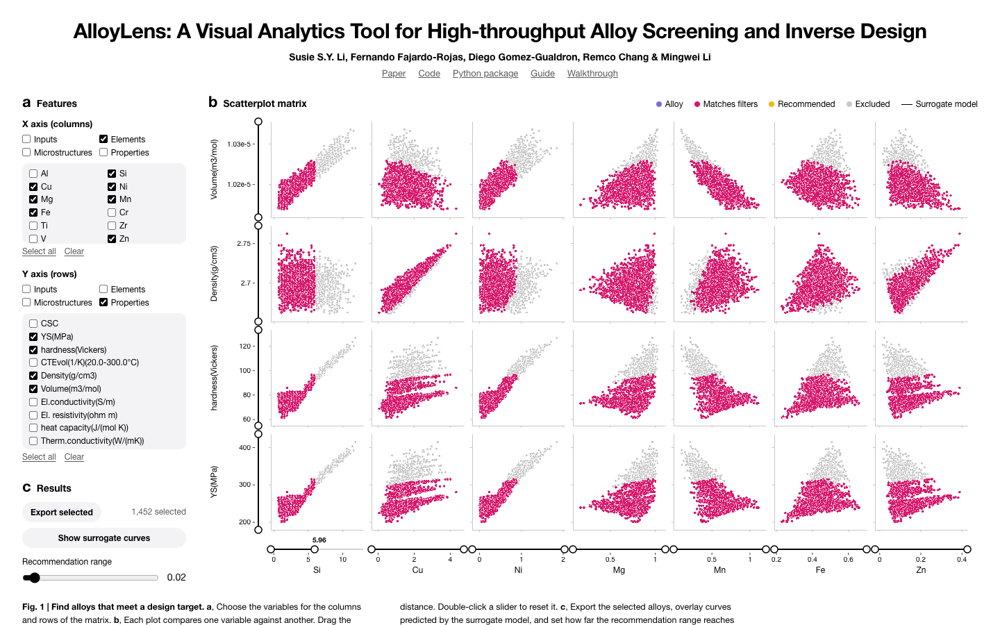

# AlloyLens

## Introduction

AlloyLens is an interactive visualization tool for visualizing and exploring high dimensional, high throughput alloy data. AlloyLens uses a novel framework to allow for real-time steering and exploration of data for inverse material design.

AlloyLens received an Honorable Mention in the IEEE VIS 2025 Scientific Visualization Contest. Read the [paper on arXiv](https://arxiv.org/abs/2511.02133) or try the [web demo](https://susiesyli.com/alloylens-web/).



### Python

Installation with `pip`

```
pip install alloylens
```

### Usage:

```python
import alloylens as al
import pandas as pd

# Load alloy dataset
df = pd.read_csv("./Rapid_Alloy_development.txt")

# Define feature groups
all_cols = df.columns.tolist()
element_cols = all_cols[6:18]
microstructure_cols = all_cols[18:56]
property_cols = all_cols[56:70]

groups = {"elements": element_cols, "microstructures": microstructure_cols, "properties": property_cols}

# Run alloylens
app = al.AlloyLensApp(df, groups, x="elements", y="properties")
app

```


### Web demo:
[susiesyli.com/alloylens-web/](https://susiesyli.com/alloylens-web/)

The source for the web demo is in [`web/`](web/). To preview it locally, run `cd web && python3 -m http.server 8000`, then open <http://localhost:8000>.

## Repository layout

- `src/alloylens/`: the Python package published to PyPI
- `examples/`: example notebook for the Python package
- `web/`: the web demo
- `surrogate/`: the surrogate model, its training notebooks, and checkpoints

## Dataset

AlloyLens was built for the [2025 IEEE SciVis Contest](https://sciviscontest2025.github.io) dataset by Katrin Bugelnig and Guillermo Requena, available on [Zenodo](https://zenodo.org/records/15189444) under [CC BY 4.0](https://creativecommons.org/licenses/by/4.0/). The web demo uses a sample of this dataset in `web/data/sample.csv`.

## Citation

If you use AlloyLens in your research, please cite the [paper](https://arxiv.org/abs/2511.02133). GitHub's "Cite this repository" button gives the reference in APA and BibTeX formats.

## Team

Susie S.Y. Li, Fernando Fajardo-Rojas, Diego Gomez-Gualdron, Remco Chang, and Mingwei Li.